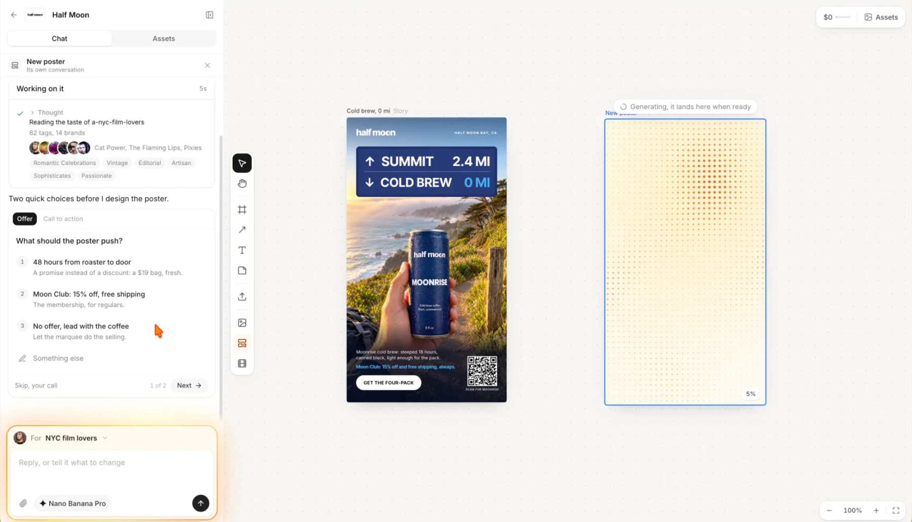
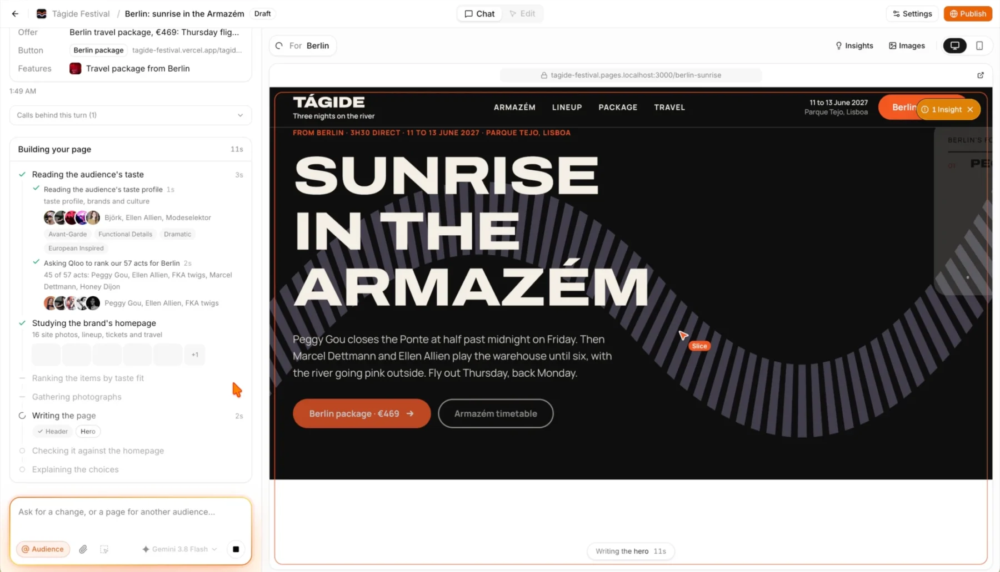
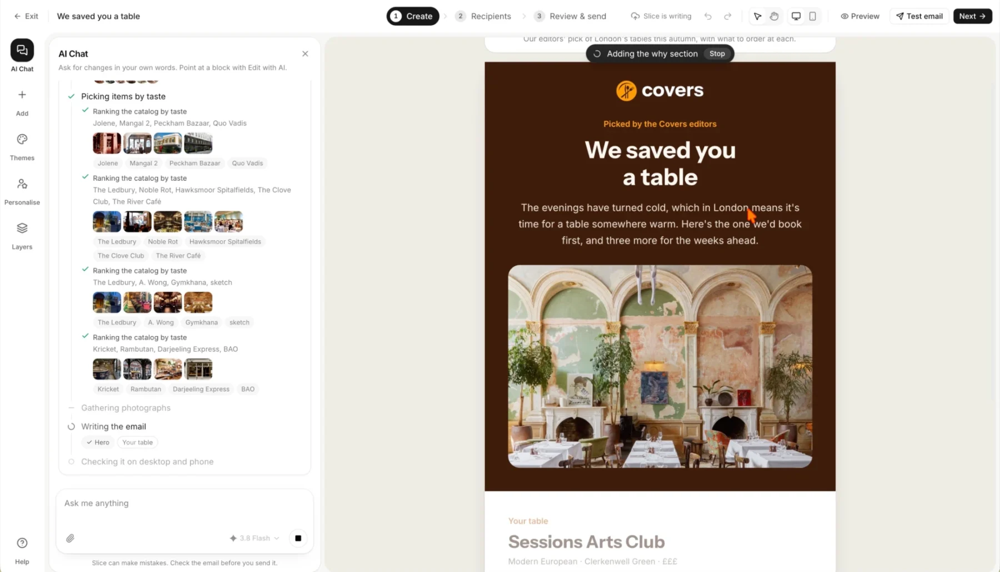
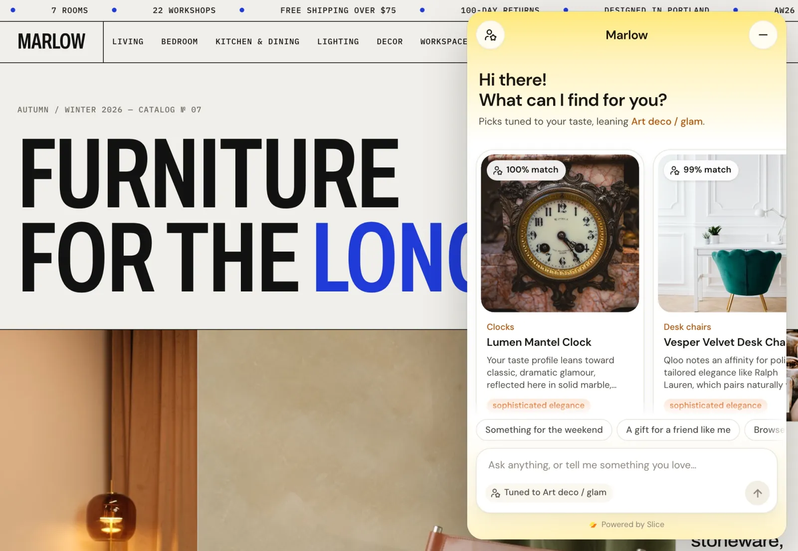
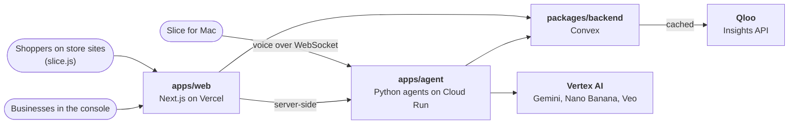

<p align="center">
  <picture>
    <source media="(prefers-color-scheme: dark)" srcset="apps/web/public/brand/slice_logo_whttext.svg">
    
  </picture>
</p>

<h3 align="center">Agents, with taste.</h3>

<p align="center">
  AI agents that make ads, landing pages and emails, guide shoppers in a store,<br>
  and run errands on your Mac, all starting from what people actually love.
</p>

<p align="center">
  <a href="https://slice-agents.vercel.app"></a>
  <a href="https://storage.googleapis.com/slice-for-mac/Slice.dmg"></a>
  <a href="LICENSE"></a>
</p>

---

Slice is five AI agents on one taste graph. Each agent starts with a read of its audience from [Qloo](https://www.qloo.com/)'s cultural taste graph (the artists, films, books, brands and places people love, and what those say about them) and calls Qloo as a tool while it works. That lets it personalize for a city, an audience or a single customer, even on a first visit with no history, and every result shows the evidence behind it.

| Agent             | What it makes                                                   |
| ----------------- | --------------------------------------------------------------- |
| **Media**         | Posters, ad creatives and short videos for a taste audience     |
| **Pages**         | Landing and funnel pages, one per audience or per lead          |
| **Email**         | Campaigns with a version for each taste group or person         |
| **Concierge**     | A shopping assistant that recommends from a store's own catalog |
| **Slice for Mac** | A voice agent in the notch that works across your apps          |

## Try it

Open **[slice-agents.vercel.app](https://slice-agents.vercel.app)** and choose **Continue as guest**. You get a workspace that already holds two demo brands for every service, no sign-up needed.

<table>
  <tr>
    <td width="50%" valign="top">
      
      <p align="center"><sub><b>Media.</b> Designing a Half Moon Coffee poster for NYC film lovers.</sub></p>
    </td>
    <td width="50%" valign="top">
      
      <p align="center"><sub><b>Pages.</b> Building a Tágide Festival page for visitors from Berlin.</sub></p>
    </td>
  </tr>
  <tr>
    <td width="50%" valign="top">
      
      <p align="center"><sub><b>Email.</b> A Covers campaign, with restaurants ranked by taste.</sub></p>
    </td>
    <td width="50%" valign="top">
      
      <p align="center"><sub><b>Concierge.</b> The widget on Marlow, with picks tuned to the shopper.</sub></p>
    </td>
  </tr>
</table>

## Products

Each service stands on its own: a business uses the ones it needs, and each has its own clients and data.

### Media

An infinite canvas where a brand makes posters, ad creatives and short videos for one audience at a time. The agent reads the audience's taste, asks a couple of quick questions about the offer, then generates with Nano Banana (Gemini image models) and Veo 3.1. Every creative comes with a **Why** report built from Qloo signals and a simulated pre-test panel.

Demo brands: [Knock](https://knock-la.vercel.app/knock), a Los Angeles food delivery app, and [Half Moon Coffee](https://halfmoon-coffee.vercel.app/halfmoon), a direct-to-consumer roaster.

### Pages

Landing and funnel pages built in conversation with an agent, one page per audience: a city, an age group, a set of interests, a cluster of the brand's own customers (from a CSV, HubSpot or Salesforce) or a single lead. The agent studies the brand's live site for its kit (logo, colors, type, buttons), writes the page in HTML and CSS, checks its own render and revises. Pages can be edited by hand, are published at `/p/{brand}/{page}`, and come with first-party analytics and a heat map.

Demo brands: [Tágide Festival](https://tagide-festival.vercel.app/tagide), a music festival in Lisbon, and [Gwen](https://gwen-card.vercel.app/gwen), a premium credit card.

### Email

An AI email builder for campaigns that send a different version to each taste group or person. The agent picks items from the brand's catalog by taste, writes and lays out each version, and checks it on desktop and phone. Sending goes through Resend.

Demo brands: [Stackhouse Books](https://stackhouse-books.vercel.app/stackhouse), a bookshop, and [Covers](https://covers-london.vercel.app/covers), a London restaurant booking app.

### Concierge

A shopping assistant a store adds with one script tag. It opens with a short taste questionnaire built from Qloo's view of the shopper's city, then recommends from the store's own catalog with a one-line reason for each pick. Catalogs sync from Shopify or WooCommerce, or load from a CSV in the Slice format. The merchant console shows conversations, taste insights across shoppers, and catalog health.

Demo stores: [Marlow](https://slice-shops.vercel.app/marlow), home and living, and [Fold](https://slice-shops.vercel.app/fold), multi-brand fashion.

### Slice for Mac

A personal agent that lives in the MacBook notch. Hold **fn + control** and talk. A Gemini Live voice handles the conversation, while a background worker and a computer-use operator do the longer tasks across your apps and screen, with your taste in mind. It connects to Gmail, Google Calendar, Drive, Slack, Notion and more through Composio.

[Download the notarized DMG](https://storage.googleapis.com/slice-for-mac/Slice.dmg) (macOS 15 or later).

## How the agents use taste

- **Taste is the brief.** Before an agent starts, it gets a Qloo read of its audience: the entities and tags that define a city, a demographic, a set of interests, a customer cluster, or a shopper's answers to the questionnaire.
- **Qloo is a set of tools.** While it works, the agent calls Qloo when it needs more, such as insights for a place, related entities, audience demographics or brand affinities, and decides for itself when and how.
- **Every result shows its evidence.** Picks, pages, emails and creatives carry the Qloo signals they rest on, so a business can see why the agent chose what it chose.

All Qloo requests go through a cache in Convex (`packages/backend/convex/qloo.ts`). Responses are stored privately on the server and never committed to this repository.

## Architecture



- **apps/web** serves the console, the Concierge UI that `slice.js` opens on a store, and published pages. It calls the agents server-side only.
- **apps/agent** runs the Concierge, Pages, Email and Media agents (Google ADK, FastAPI) and the Slice for Mac brain.
- **packages/backend** holds the data, files and auth checks, and is the only path to Qloo.

### Tech stack

| Layer                  | Built with                                                                                                       |
| ---------------------- | ---------------------------------------------------------------------------------------------------------------- |
| Web app and demo sites | Next.js 16, React 19, Tailwind CSS 4, shadcn/ui, Clerk                                                           |
| Store widget           | TypeScript, Vite                                                                                                 |
| Backend and data       | Convex                                                                                                           |
| Agents                 | Python, Google ADK, FastAPI, Gemini 3.8 Flash on Vertex AI, Playwright                                           |
| Image and video        | Nano Banana 2 and Pro, Veo 3.1                                                                                   |
| Taste                  | Qloo Insights API                                                                                                |
| Integrations           | Composio (Shopify, HubSpot, Salesforce, Google Workspace, Slack, Notion), WooCommerce, Resend, Firecrawl, Pexels |
| Mac app                | Swift, SwiftUI, XcodeGen, Gemini Live                                                                            |
| Hosting                | Vercel, Google Cloud Run                                                                                         |
| Monorepo               | pnpm workspaces, Turborepo                                                                                       |

### Repository layout

```
apps/
  web/            Next.js app: landing page, console (/dashboard), concierge UI (/embed), published pages (/p)
  widget/         slice.js, the script tag a store adds
  agent/          Python agents and API server: Concierge, Pages, Email, Media, catalog sync, the Mac brain
  mac/            Slice for Mac, the Swift notch app
  stores/         Demo brand sites: Marlow, Fold, Tágide, Gwen, Knock, Half Moon, Stackhouse, Covers
packages/
  backend/        Convex schema, functions, HTTP routes and the Qloo cache
  qloo/           Typed client for the Qloo API
  demo-catalogs/  Marlow and Fold product catalogs, with validation and export scripts
  demo-data/      Customer datasets and a seed script for the Pages demos
docs/             Design notes, contracts and runbooks
```

## Local development

### Prerequisites

- Node.js 20.9 or later and pnpm 10 (`corepack enable`)
- [uv](https://docs.astral.sh/uv/) and Python 3.11 or later
- A [Convex](https://www.convex.dev/) project, a [Clerk](https://clerk.com/) application, a Google Cloud project with Vertex AI enabled, and a Qloo API key
- Optional, per feature: Resend (sending email), Composio (Shopify, CRMs, Mac integrations), Firecrawl and Pexels (Pages intake and imagery)
- Optional, for the Mac app: Xcode and XcodeGen (`brew install xcodegen`)

### 1. Install

```bash
pnpm install
```

### 2. Clerk

1. In the [Clerk dashboard](https://dashboard.clerk.com), open your application, go to **API keys**, and copy the publishable and secret keys.
2. On the [Convex integration page](https://dashboard.clerk.com/apps/setup/convex), select the application and click **Activate Convex integration**. Copy the **Frontend API URL** it shows (`https://<name>.clerk.accounts.dev`).

### 3. Convex

```bash
pnpm --filter @slice/backend run convex:setup
```

Log in, choose **existing project** and pick your project. This writes `packages/backend/.env.local` with `CONVEX_DEPLOYMENT` and `CONVEX_URL`.

The first push fails until Convex knows the Clerk issuer. Set it from a second terminal and the running setup retries on its own:

```bash
cd packages/backend
npx convex env set CLERK_JWT_ISSUER_DOMAIN https://<name>.clerk.accounts.dev
```

Then give Convex the Qloo key and a shared secret for the agent:

```bash
npx convex env set QLOO_API_KEY <your-qloo-key>
npx convex env set QLOO_PROXY_SECRET $(openssl rand -hex 32)
```

The agent needs the same secret in step 4; read it back with `npx convex env get QLOO_PROXY_SECRET`.

To send email, also set `RESEND_API_KEY` and `RESEND_WEBHOOK_SECRET`.

### 4. Environment files

```bash
cp apps/web/.env.example apps/web/.env.local
cp apps/widget/.env.example apps/widget/.env.local
cp apps/stores/.env.example apps/stores/.env.local
cp apps/agent/.env.example apps/agent/.env
```

| File                                               | Fill in                                                                                                                                                                |
| -------------------------------------------------- | ---------------------------------------------------------------------------------------------------------------------------------------------------------------------- |
| `apps/web/.env.local`                              | `NEXT_PUBLIC_CONVEX_URL` (the `CONVEX_URL` from step 3) and the two Clerk keys                                                                                         |
| `apps/agent/.env`                                  | `GOOGLE_CLOUD_PROJECT`, `GOOGLE_APPLICATION_CREDENTIALS` (a service account key with the Vertex AI User role), `CONVEX_URL`, `CONVEX_SITE_URL` and `QLOO_PROXY_SECRET` |
| `apps/widget/.env.local`, `apps/stores/.env.local` | Nothing; the defaults point at the local servers                                                                                                                       |

The optional keys (Composio, Firecrawl, Pexels, Shopify, WooCommerce) are documented inline in `apps/agent/.env.example`. The Google credentials and the Qloo key live only in the agent and in Convex, never in the web app or the widget.

### 5. Run

```bash
pnpm dev
```

This starts Convex, the web app, the widget, the demo sites and the agent server together.

| Service             | Address                                                                                                          |
| ------------------- | ---------------------------------------------------------------------------------------------------------------- |
| Web app and console | http://localhost:3000                                                                                            |
| Demo brand sites    | http://localhost:3002/marlow (also `/fold`, `/tagide`, `/gwen`, `/knock`, `/halfmoon`, `/stackhouse`, `/covers`) |
| Widget playground   | http://localhost:5173                                                                                            |
| Agent server        | http://localhost:8000                                                                                            |

To load the Marlow and Fold catalogs into Convex:

```bash
cd packages/backend && npx convex run seedDemo:seed
```

### Scripts

| Command                                           | What it does                                |
| ------------------------------------------------- | ------------------------------------------- |
| `pnpm dev`                                        | Run every app in development                |
| `pnpm build`                                      | Production builds                           |
| `pnpm typecheck`, `pnpm lint`, `pnpm format`      | Type-check, lint and format the whole repo  |
| `pnpm --filter @slice/mac app`                    | Build Slice for Mac (Debug) and relaunch it |
| `pnpm --filter @slice/mac release`                | Build, sign and notarize the Mac DMG        |
| `pnpm --filter @slice/demo-catalogs validate`     | Check the demo catalogs against the schema  |
| `cd packages/backend && npx convex run qloo:warm` | Pre-cache the Qloo requests the demos use   |

## Adding the Concierge to a store

Create a widget in the console, then paste its snippet into the store's theme:

```html
<script
  src="https://slice-agents.vercel.app/slice.js"
  data-slice-key="<store-key>"
  async
></script>
```

The console's **Install** tab also has the snippet for Shopify, Next.js and Tag Manager, limits the widget to the store's own domains, and shows every site it has loaded on.

## Deployment

The web app and demo sites deploy to Vercel from `main`, the agents run on Google Cloud Run, and Slice for Mac ships as a Developer ID signed, notarized DMG. See [`docs/deploy.md`](docs/deploy.md) and [`docs/mac-release.md`](docs/mac-release.md).

## Documentation

| Topic         | Docs                                                                                                                                                                                                              |
| ------------- | ----------------------------------------------------------------------------------------------------------------------------------------------------------------------------------------------------------------- |
| Deployment    | [deploy.md](docs/deploy.md), [mac-release.md](docs/mac-release.md)                                                                                                                                                |
| Pages         | [pages-plan.md](docs/pages-plan.md), [pages-contracts.md](docs/pages-contracts.md), [pages-html-builder.md](docs/pages-html-builder.md), [pages-crm.md](docs/pages-crm.md), [tagide-eval.md](docs/tagide-eval.md) |
| Email         | [email-plan.md](docs/email-plan.md)                                                                                                                                                                               |
| Concierge     | [concierge-stores.md](docs/concierge-stores.md), [demo-stores.md](docs/demo-stores.md), [test-taste-profiles.md](docs/test-taste-profiles.md)                                                                     |
| Slice for Mac | [mac-plan.md](docs/mac-plan.md)                                                                                                                                                                                   |

## License

[MIT](LICENSE)
